# Organización Computacional 
## Práctica 1 - Visualizador de 7 Segmentos
**Estudiante:** Diego José Castro Lux - 202300627

**Estudiante:** Ludsvin Anthony Marcelino Cuxum Cahuec - 202300497

**Estudiante:** Jonathan Eduardo Fuentes Garcia - 202408977

**Estudiante:** Andre Emanuel Negreros Pacaya - 202401461

## Introducción
La presente práctica consiste en el diseño e implementación de un sistema de visualización mediante displays de 7 segmentos, aplicando conceptos de lógica combinacional, álgebra booleana y electrónica digital. El sistema tiene como finalidad representar una palabra de ocho caracteres utilizando diferentes combinaciones de los segmentos que conforman cada display.

Para el desarrollo de la práctica se implementan dos formas de visualización. La primera corresponde a la parte frontal, utilizando un display de 7 segmentos de cátodo común y funciones booleanas expresadas mediante términos mínimos. La segunda corresponde a la parte trasera, utilizando un display de ánodo común y considerando la representación en espejo, por lo que se emplean términos máximos y lógica activa en bajo. Estas características permiten que la información pueda visualizarse desde ambos lados del sistema.

## Simulación en Proteus
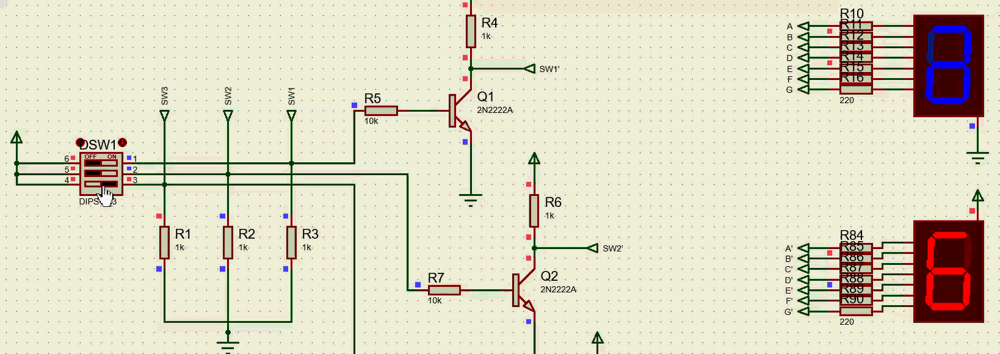

## Diagramas de Diseño
### Display Ánodo y Cátodo

## Modo normal (Cátodo Común)
### Segmento A

### Segmento B

### Segmento C
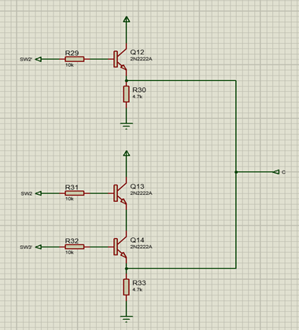

### Segmento D
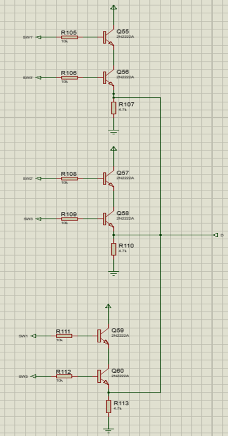

### Segmento E
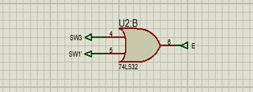

### Segmento F
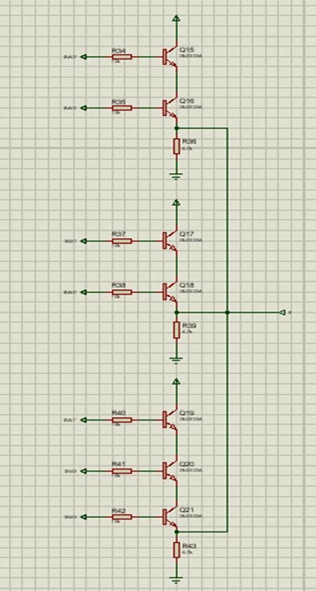

### Segmento G
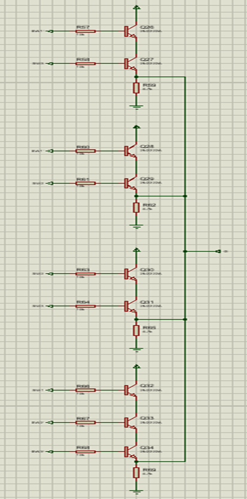

### Segmento Punto
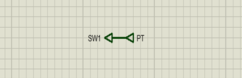

## Modo Espejo (Ánodo Común)
### Segmento A
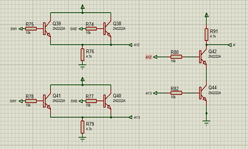

### Segmento B
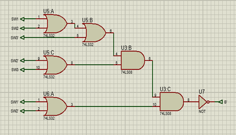

### Segmento C
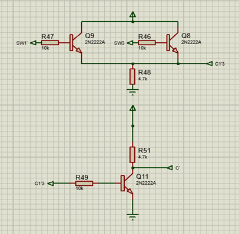

### Segmento D
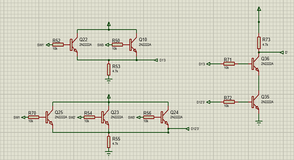

### Segmento E
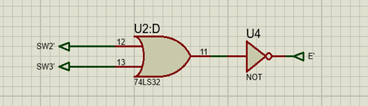

### Segmento F
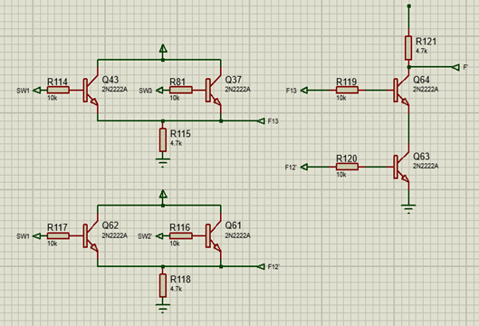

### Segmento G
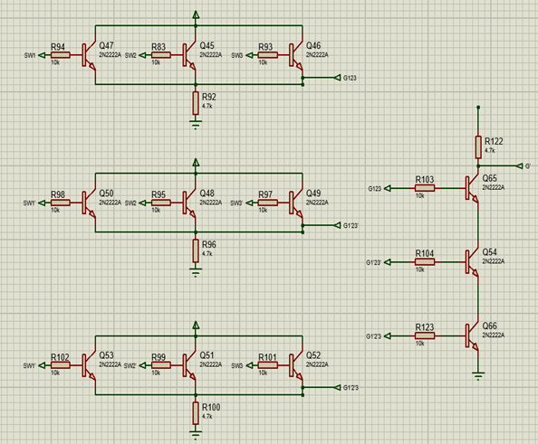

### Segmento Punto

## Circuito Físico
A continuación, se presentan las fotografías del circuito real.

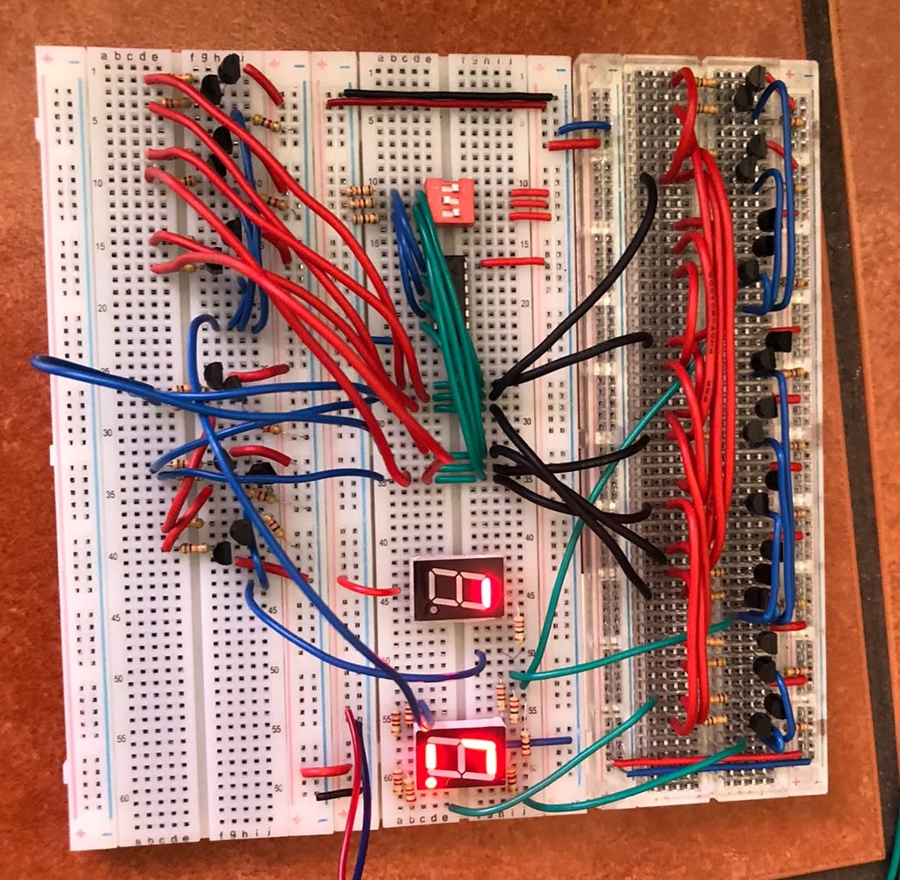

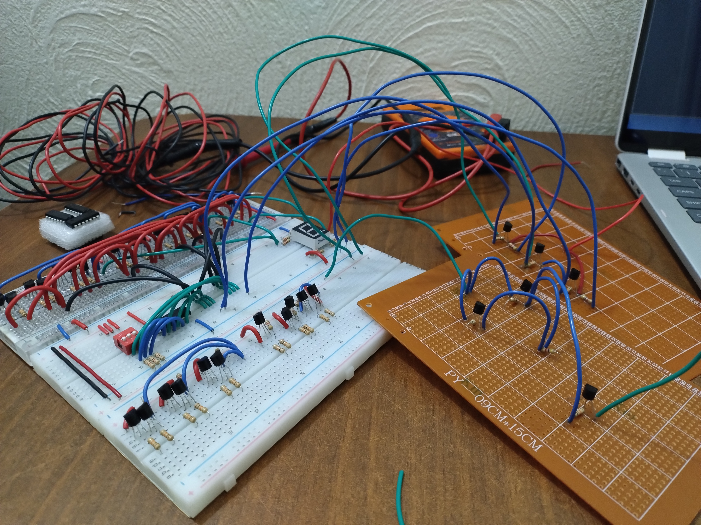

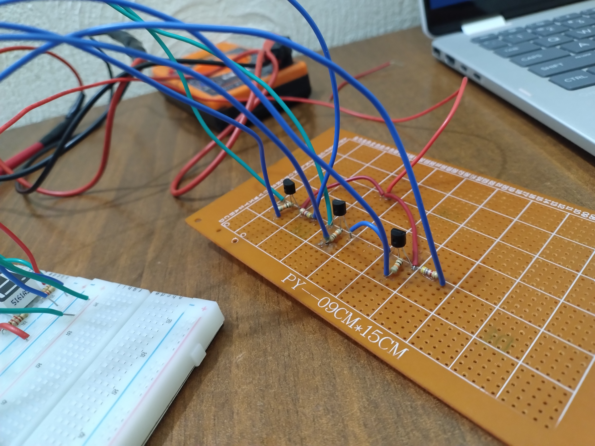

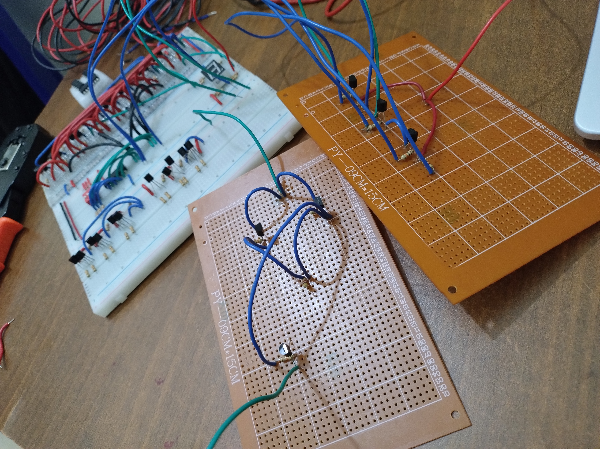