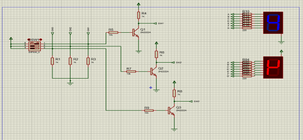
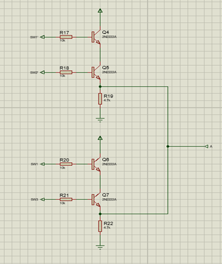
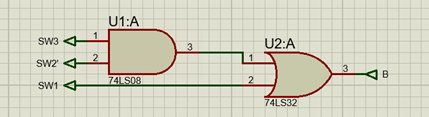

# Práctica 1 - Visualizador de 7 Segmentos

**Curso:** Organización Computacional 
**Estudiante:** [Tu Nombre] - [Tu Carnet/Matrícula]

---

## Introducción
La presente práctica consiste en el diseño e implementación de un sistema de visualización mediante displays de 7 segmentos, aplicando conceptos de lógica combinacional, álgebra booleana y electrónica digital. El sistema tiene como finalidad representar una palabra de ocho caracteres utilizando diferentes combinaciones de los segmentos que conforman cada display.

## Diagramas de Diseño
### Display Anodo y Catodo

### Segemento A

### Segemento B

## Circuito Físico
A continuación, se presentan las fotografías del circuito real ensamblado y funcionando:

