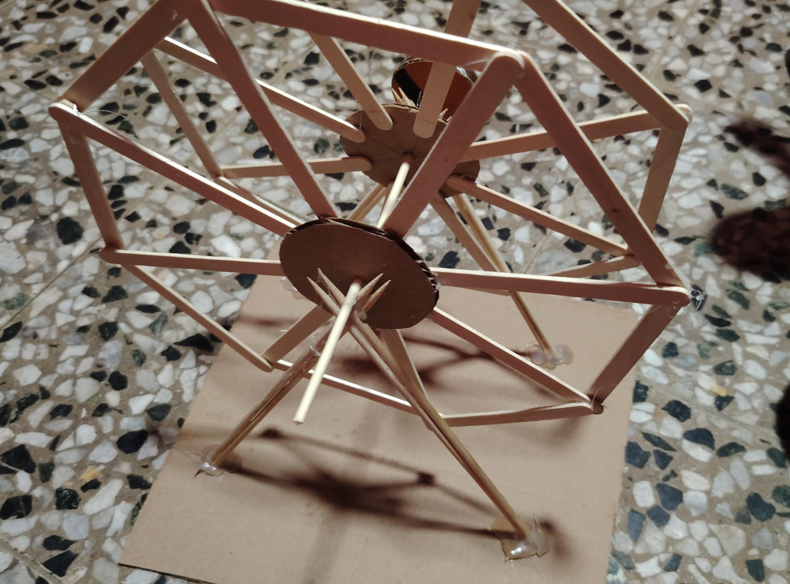
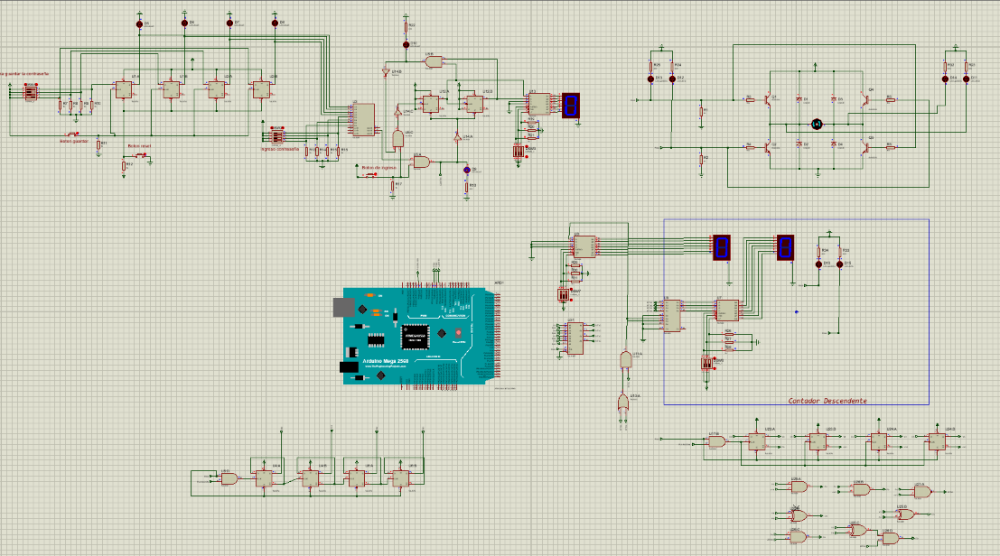
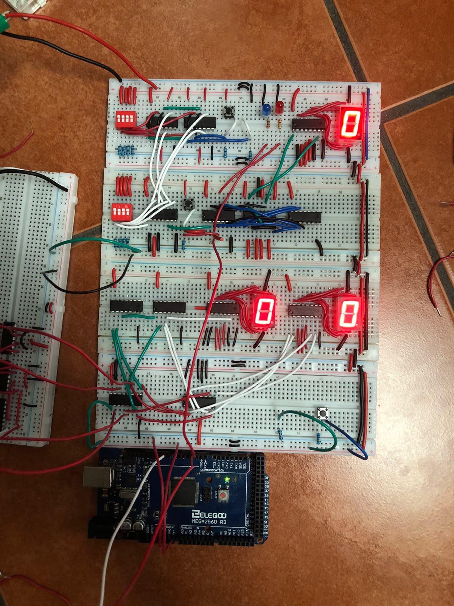
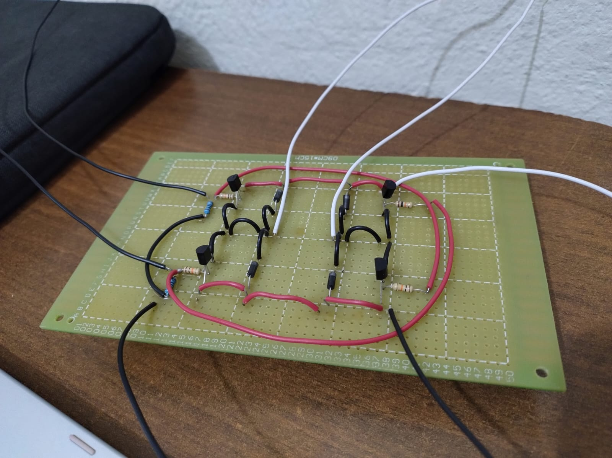

# Organización Computacional

## Práctica 3 - Rueda de la Fortuna Automatizada

**Universidad de San Carlos de Guatemala**
**Facultad de Ingeniería - Ingeniería en Ciencias y Sistemas**
**Semestre:** Segundo Semestre 2026

**Estudiante 1:** Diego José Castro Lux - 202300627

**Estudiante 2:** Ludsvin Anthony Marcelino Cuxum Cahuec - 202300497

**Estudiante 3:** Jonathan Eduardo Fuentes Garcia - 202408977

**Estudiante 4:** Andre Emanuel Negreros Pacaya - 202401461

---

## Introducción

La presente práctica documenta el diseño, simulación y construcción de una **Rueda de la Fortuna Automatizada** desarrollada para la empresa TecnoParques S.A. El objetivo del proyecto es implementar un sistema de control basado en lógica combinacional y secuencial que garantice la seguridad y la eficiencia de la atracción. 

El sistema integra un mecanismo de acceso seguro mediante una contraseña de 4 bits, un contador de errores con alarma, y la gestión automática de los tiempos de operación del motor. El giro bidireccional del carrusel se controla a través de un puente H, y el tiempo de cada fase se visualiza en displays de 7 segmentos sincronizados con pulsos de reloj generados por un Arduino

<!-- PEGAR AQUÍ IMAGEN: Fotografía general del proyecto terminado (maqueta + circuitos) -->

## Arquitectura del Sistema

El proyecto se divide en módulos interconectados que manejan la autenticación, la temporización y la potencia.

### 1. Módulo de Contraseña y Autenticación
El acceso al sistema está protegido por una contraseña de 4 bits. 
* **Almacenamiento:** Utiliza 4 flip-flops tipo D para guardar la contraseña al presionar el botón "Guardar".
* **Ingreso:** El usuario introduce la clave mediante un switch de 4 posiciones.
* **Validación:** Un comparador de 4 bits (7485) verifica si la clave ingresada coincide con la almacenada.

### 2. Módulo Contador de Errores y Alarma
Sistema de seguridad que bloquea la atracción ante intentos no autorizados.
* Implementado con flip-flops tipo D en configuración de cascada.
* Cuenta los intentos fallidos y los muestra en un display de 7 segmentos.
* Al llegar a 3 errores consecutivos, activa una alarma (Buzzer) que solo se desactiva ingresando la contraseña correcta.

<!-- PEGAR AQUÍ IMAGEN: Captura del circuito del contador de errores y buzzer en Proteus -->

### 3. Módulo de Temporización y Secuencia
Controla el tiempo de funcionamiento de la rueda de la fortuna una vez autorizado el acceso.
* **Fase 1 (Verde):** Un contador ascendente cuenta de 0 a 15 segundos, encendiendo un LED verde.
* **Fase 2 (Roja):** Un contador descendente cuenta de 10 a 0 segundos, encendiendo un LED rojo y cambiando la dirección del giro.
* Los tiempos se muestran utilizando decodificadores BCD a 7 segmentos (7447/7448) y displays.

<!-- PEGAR AQUÍ IMAGEN: Captura del circuito de los contadores ascendente/descendente en Proteus -->

### 4. Módulo de Control del Motor DC (Puente H)
Se encarga de la etapa de potencia y el movimiento físico de la rueda.
* Construido con transistores discretos (NPN 2N2222A).
* Recibe las señales del Arduino para invertir la polaridad y cambiar el sentido de giro del motor DC según la fase activa.

<!-- PEGAR AQUÍ IMAGEN: Captura del diseño del Puente H en Proteus o en software de diseño de PCB -->

---

## Simulación Completa en Proteus

A continuación se presenta el circuito lógico digital completo simulado en Proteus, integrando todos los módulos descritos anteriormente.

<!-- PEGAR AQUÍ IMAGEN: Captura panorámica de todo el circuito funcionando en Proteus -->

---

## Componentes y Herramientas Utilizadas

El hardware utilizado cumple con las especificaciones y restricciones de la práctica:

| Componente | Código / Modelo | Función |
| :--- | :--- | :--- |
| Compuerta AND | 7408 | Lógica combinacional |
| Compuerta NOT | 7404 | Lógica combinacional |
| Compuerta XOR | 7486 | Lógica combinacional |
| Compuerta OR | 7432 | Lógica combinacional |
| Transistores | 2N2222A | Construcción del Puente H |
| Comparador | 7485 | Validación de contraseña |
| Decodificador | 7447 / 7448 | Control de displays de 7 segmentos |
| Multiplexor | 74157 | Selección de señales de control |
| Flip-Flop D | 74LS74 / 74LS174 | Almacenamiento y contadores |
| Microcontrolador | Arduino Uno/Mega | Generación de reloj y control |

*(Para ver el presupuesto detallado, referirse al manual técnico en PDF adjunto a este repositorio).*

---

## Implementación Física (Circuitos)

En esta sección se documenta el proceso de ensamblado físico, mostrando las placas, cableado estructurado y la integración con la maqueta mecánica de la rueda de la fortuna.

### 1. Placa Principal y Protoboards
<!-- PEGAR AQUÍ IMAGEN: Fotografía de los protoboards con los integrados TTL cableados -->

### 2. Puente H en PCB
<!-- PEGAR AQUÍ IMAGEN: Fotografía de la placa PCB fabricada para el Puente H -->

---

## Estructura del Repositorio

- **`/Simulacion`**: Contiene el archivo `.pdsprj` compatible con Proteus.
- **`/Codigo`**: Contiene el archivo `.ino` cargado en el Arduino para la generación de pulsos de reloj y sincronización.
- **`/Documentacion`**: Contiene el manual técnico en PDF con los diagramas, mapas de Karnaugh, funciones booleanas y conclusiones del proyecto.