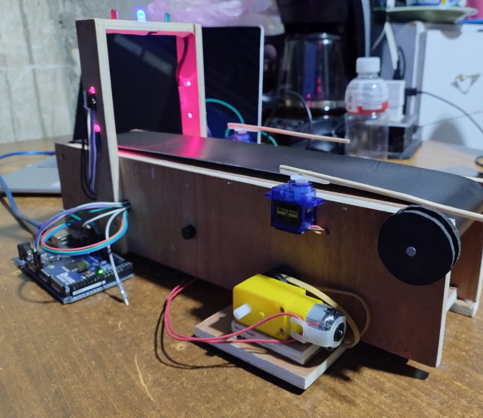
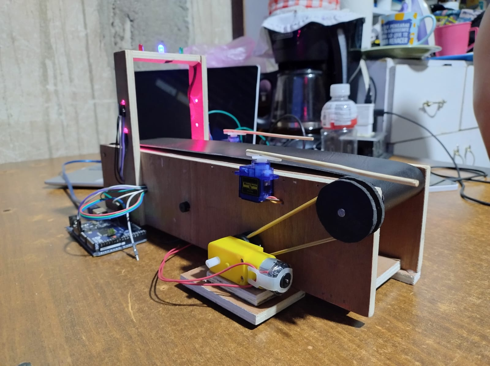
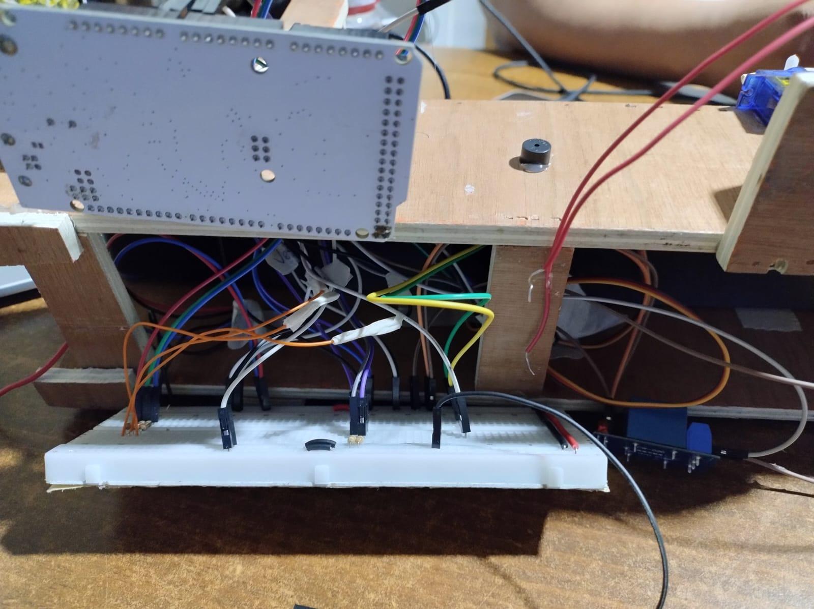

 <div align="center">

<p align="left" style="font-size: 18px; font-weight: bold; margin: 0;">UNIVERSIDAD DE SAN CARLOS DE GUATEMALA</p>
<p align="left" style="font-size: 18px; font-weight: bold; margin: 5px 0;">FACULTAD DE INGENIERÍA</p>
<p align="left" style="font-size: 18px; font-weight: bold; margin: 5px 0;">ESCUELA DE CIENCIAS Y SISTEMAS</p>
<p align="left" style="font-size: 18px; font-weight: bold; margin: 5px 0;">ORGANIZACIÓN COMPUTACIONAL</p>

<br><br>

<p align="center" style="font-size: 32px; font-weight: bold; margin: 0;">Manual Técnico</p>

<br>

<p align="center" style="font-size: 28px; font-weight: bold; margin: 0;">SmartSort GT</p>

<br><br>


<br><br><br>

<p align="center" style="font-size: 20px; font-weight: bold; margin: 0;">Integrantes</p>

<br>

<table align="center">
  <thead>
    <tr>
      <th align="center">Carné</th>
      <th align="center">Nombre completo</th>
    </tr>
  </thead>
  <tbody>
    <tr>
      <td align="center">202300497</td>
      <td align="center">Ludsvin Anthony Marcelino Cuxum Cahuec</td>
    </tr>
    <tr>
      <td align="center">202300627</td>
      <td align="center">Diego Jose Castro Lux</td>
    </tr>
    <tr>
      <td align="center">202408977</td>
      <td align="center">Jonathan Eduardo Fuentes Garcia</td>
    </tr>
    <tr>
      <td align="center">202401461</td>
      <td align="center">Andre Emanuel Negreros Pacaya</td>
    </tr>
  </tbody>
</table>

<br><br>

<p align="center" style="font-size: 16px; margin: 0;">Guatemala, octubre de 2026</p>

</div>

## 1. Introducción

SmartSort GT es un proyecto del curso de Organización Computacional de la Facultad de Ingeniería de la USAC, planteado como un reto de Cargo Rapido GT, empresa guatemalteca de mensajería. Su centro de distribución clasifica los paquetes de forma manual, lo que genera errores de desvío, no deja registro de lo procesado por turno y depende del criterio del operario.

Como solución se desarrolla un prototipo de clasificadora automática de paquetes, construido sobre una maqueta de banda transportadora y controlado por un Arduino. Dos sensores láser (diodo láser y LDR) colocados a distintas alturas determinan si cada paquete es pequeño, grande o de rechazo, y dos servomotores lo desvían al contenedor correspondiente.

El sistema guarda las estadísticas de producción en la EEPROM, de modo que no se pierden ante reinicios o cortes de energía. El operario lo controla desde su smartphone por Bluetooth (HC-06) y sigue el estado en una pantalla LCD, con apoyo de LEDs y un buzzer. Con esto se busca demostrar que microcontroladores de bajo costo pueden automatizar un proceso de clasificación con registros confiables.

## 2. Objetivos

### 2.1. Objetivo general

Implementar un prototipo funcional de clasificadora automática de paquetes basado en Arduino, que detecte el tamaño mediante sensores láser, desvíe los paquetes con servomotores y registre estadísticas de producción en la EEPROM, con control remoto vía Bluetooth.

### 2.2. Objetivos específicos

1. Construir una maqueta con banda transportadora, portal de detección con dos sensores láser, dos servomotores desviadores y tres contenedores (pequeño, grande y rechazo).
2. Clasificar correctamente al menos 10 paquetes consecutivos, sin errores de desvío, sincronizando la detección con la activación de los servomotores.
3. Almacenar en la EEPROM los contadores de paquetes grandes, pequeños, rechazados y el total histórico, con validación de rango y persistencia tras reiniciar el Arduino.
4. Controlar el sistema desde un smartphone mediante el módulo HC-06, con todos los comandos definidos (`iniciar`, `pausa`, `detener`, `reporte`, `Resetear`, `modo_lote:N`, `modo_normal`, `modo_mantenimiento` y `estado`).
5. Informar al operario en tiempo real mediante la pantalla LCD, los LEDs de estado y el buzzer.
6. Gestionar todos los tiempos con `millis()`, sin usar `delay()` en el ciclo principal.

## 3. Descripción general del sistema

SmartSort GT es un sistema embebido que combina componentes electrónicos, programación y una estructura mecánica para automatizar la clasificación de paquetes.

El sistema está compuesto por una banda transportadora que desplaza los objetos, un portal de detección con dos sensores ópticos, dos servomotores desviadores, tres contenedores y un conjunto de dispositivos de control y visualización.

El Arduino recibe las lecturas de los sensores y determina la categoría del paquete de acuerdo con la lógica programada. Posteriormente, activa el servomotor correspondiente cuando se identifica un paquete pequeño o grande. Si el objeto se identifica como rechazo, los servomotores permanecen en posición neutral para permitir su paso hacia el contenedor central.

Además de la clasificación física, el sistema registra las cantidades procesadas en la EEPROM y permite consultar información mediante la pantalla LCD. La comunicación Bluetooth proporciona una interfaz para enviar instrucciones desde un teléfono inteligente.

### 3.1. Módulos principales

| Módulo | Componentes principales | Función |
|---|---|---|
| Unidad de control | Arduino  Mega | Procesa las señales y coordina los módulos del sistema. |
| Detección óptica | Dos diodos láser y dos LDR | Detecta la interrupción de los haces de luz. |
| Transporte | Motor DC y banda transportadora | Desplaza los paquetes por el sistema. |
| Clasificación | Dos servomotores | Desvía los paquetes hacia sus respectivos contenedores. |
| Comunicación | Módulo Bluetooth HC-05 | Recibe comandos enviados desde una aplicación móvil. |
| Visualización | Pantalla LCD I2C de 16x2 | Presenta mensajes de estado y estadísticas. |
| Indicadores | LED azul, verde y rojo | Comunican visualmente el estado y los resultados de clasificación. |
| Alerta sonora | Buzzer | Emite sonidos asociados a determinados eventos. |
| Almacenamiento | EEPROM interna del Arduino | Conserva las estadísticas de producción. |

### 3.2. Arquitectura de funcionamiento

El sistema sigue una secuencia general de operación:

1. El Arduino inicia los periféricos y recupera las estadísticas almacenadas en la EEPROM.
2. El sistema activa el indicador azul para señalar que está encendido.
3. El operador envía el comando correspondiente mediante Bluetooth.
4. Cuando la banda está activa, el Arduino consulta las lecturas de los sensores LDR.
5. El programa compara las lecturas con un umbral de iluminación configurado.
6. De acuerdo con las señales obtenidas, se determina la categoría del paquete.
7. Si corresponde, se activa el servomotor encargado del desvío.
8. Se actualizan los contadores, la pantalla LCD y los indicadores correspondientes.
9. Las estadísticas se escriben en la EEPROM.
10. El sistema continúa procesando paquetes hasta que se recibe una instrucción que modifica o detiene su funcionamiento.


## 4. Requisitos de hardware y software

### 4.1. Hardware utilizado

| Componente | Cantidad | Función |
|---|---:|---|
| Arduino Mega | 1 | Control principal del sistema. |
| Módulo Bluetooth HC-05 | 1 | Comunicación inalámbrica serial. |
| Pantalla LCD de 16x2 con I2C | 1 | Visualización de mensajes. |
| Servomotor | 2 | Desvío de paquetes grandes y pequeños. |
| Motor DC | 1 | Movimiento de la banda transportadora. |
| Diodo láser | 2 | Emisión de los haces de detección. |
| Fotorresistencia LDR | 2 | Detección de los cambios de iluminación. |
| LED azul | 1 | Indicador de sistema activo y listo. |
| LED verde | 1 | Indicador de clasificación correcta. |
| LED rojo | 1 | Indicador de rechazo o fallo, según la implementación. |
| Buzzer | 1 | Señalización sonora. |
| Resistencias y cables | Según necesidad | Conexiones y acondicionamiento eléctrico. |
| Materiales para maqueta | Según necesidad | Construcción de la estructura y los contenedores. |

Las cantidades y los modelos deben verificarse con los componentes instalados realmente en el prototipo.

### 4.2. Software y herramientas

| Herramienta | Uso |
|---|---|
| Arduino IDE | Edición, compilación y carga del programa al microcontrolador. |
| Serial Bluetooth Terminal | Envío de comandos desde un dispositivo móvil. |
| Bibliotecas de Arduino | Control de la pantalla, servomotores, memoria EEPROM y comunicación serial. |
| GitHub | Almacenamiento y control de versiones del código y la documentación. |

## 5. Conexiones

### 5.1. Distribución de pines

De acuerdo con el código fuente proporcionado, la distribución de pines es la siguiente:

| Componente | Pin del Arduino | Tipo de señal | Descripción |
|---|---|---|---|
| LDR inferior | A0 | Entrada analógica | Lectura del sensor inferior. |
| LDR superior | A1 | Entrada analógica | Lectura del sensor superior. |
| Motor de la banda | 7 | Salida digital | Señal de activación del motor. |
| Buzzer | 8 | Salida | Generación de señales sonoras. |
| LED azul | 4 | Salida digital | Indicador de sistema encendido. |
| LED verde | 5 | Salida digital | Indicador de clasificación correcta. |
| LED rojo | 6 | Salida digital | Indicador de rechazo. |
| Servomotor para grandes | 9 | Control de servo | Desvío de paquetes grandes. |
| Servomotor para pequeños | 10 | Control de servo | Desvío de paquetes pequeños. |
| Bluetooth HC-05 TX | 18, como RX del Arduino | Comunicación serial | Recepción de datos desde el módulo. |
| Bluetooth HC-05 RX | 19, como TX del Arduino | Comunicación serial | Transmisión de datos hacia el módulo. |
| LCD SDA | SDA del Arduino | Comunicación I2C | Línea de datos de la pantalla. |
| LCD SCL | SCL del Arduino | Comunicación I2C | Línea de reloj de la pantalla. |


La pantalla LCD utiliza la dirección I2C `0x27` en el código proporcionado. Si la pantalla no muestra información, se debe verificar su dirección real y las conexiones SDA, SCL, alimentación y tierra.

La conexión del motor DC debe realizarse mediante un circuito de potencia o controlador apropiado. No se debe alimentar directamente el motor desde un pin digital del Arduino.

## 6. Sistema de detección láser y calibración

### 6.1. Descripción del sistema de detección

El sistema de detección está formado por dos emisores láser y dos fotorresistencias LDR colocados a diferentes alturas. Los láseres generan haces de luz dirigidos hacia las respectivas fotorresistencias. Cuando un paquete interrumpe uno de estos haces, cambia la cantidad de luz que recibe el sensor.

La fotorresistencia modifica su resistencia eléctrica de acuerdo con la iluminación que recibe. Mediante un circuito de lectura adecuado, este cambio se convierte en una señal que el Arduino puede interpretar utilizando sus entradas analógicas.

El programa consulta las entradas A0 y A1 mediante la función `analogRead()`. Posteriormente, compara cada lectura con un umbral definido en el código. Si la lectura cae por debajo del umbral, el programa interpreta que el haz de luz correspondiente ha sido interrumpido.

### 6.2. Función de los sensores

| Sensor | Ubicación | Función |
|---|---|---|
| LDR inferior | A la altura inferior del portal | Detecta la interrupción del haz inferior. |
| LDR superior | A una altura superior del portal | Detecta la interrupción del haz superior. |

La clasificación depende de la disposición física de los sensores y de la lógica utilizada en el programa. Por ello, las alturas deben ajustarse para que las diferentes dimensiones de los paquetes produzcan señales distinguibles.

### 6.3. Lógica de clasificación implementada en el código

El programa define dos variables booleanas:

- `l1_corte`: indica si la lectura del sensor inferior está por debajo del umbral.
- `l2_corte`: indica si la lectura del sensor superior está por debajo del umbral.

La condición programada para interpretar las lecturas es la siguiente:

| Sensor inferior (`l1_corte`) | Sensor superior (`l2_corte`) | Resultado según el código |
|---:|---:|---|
| 0 | 0 | No se procesa un paquete. |
| 0 | 1 | Se clasifica como rechazo. |
| 1 | 0 | Se clasifica como pequeño. |
| 1 | 1 | Se clasifica como grande. |

La tabla describe el comportamiento de la lógica actual del código. Para que la clasificación sea correcta, es necesario comprobar que la disposición física de los sensores produce estos estados para cada tipo de paquete.

### 6.4. Calibración de los sensores

El código establece inicialmente un umbral de 800 para comparar las lecturas analógicas. Este valor debe verificarse con las lecturas reales de los LDR, ya que puede variar de acuerdo con la iluminación ambiental, la distancia del láser, las características de la fotorresistencia y las condiciones de montaje.

Se recomienda realizar el siguiente procedimiento:

1. Encender los láseres y comprobar que cada haz llegue correctamente a su LDR.
2. Leer los valores analógicos con los sensores iluminados.
3. Interrumpir cada haz por separado y registrar los valores obtenidos.
4. Comparar las lecturas con el umbral utilizado en el programa.
5. Ajustar el umbral para distinguir con suficiente margen entre los estados iluminado e interrumpido.
6. Probar con paquetes pequeños, grandes y objetos que deban rechazarse.
7. Repetir las pruebas con la iluminación y la velocidad de la banda que se utilizarán durante la demostración.


## 7. Control del motor de la banda transportadora

El motor DC es el encargado de desplazar los paquetes a través de la estructura. En el código proporcionado, el control del motor se realiza mediante el pin digital 7.

Cuando se recibe un comando que activa la banda, el programa coloca el pin en estado `HIGH`. Cuando se pausa o detiene el sistema, el pin pasa a estado `LOW`.

Es importante aclarar que el pin del Arduino proporciona una señal de control, no la potencia necesaria para alimentar directamente el motor. El circuito físico debe incorporar un transistor, controlador de motor o módulo de potencia apropiado, según las características eléctricas del motor utilizado.

### 7.1. Estados de funcionamiento

| Estado | Señal de control | Resultado esperado |
|---|---|---|
| Banda activa | `HIGH` | El circuito de potencia activa el motor. |
| Banda pausada | `LOW` | Se desactiva la señal de control del motor. |
| Banda detenida | `LOW` | El motor deja de recibir la orden de funcionamiento. |
| Modo mantenimiento | `HIGH` | La banda funciona sin ejecutar la clasificación normal según el diseño previsto. |

El comportamiento físico del motor depende del circuito de potencia utilizado y debe verificarse durante la instalación.

## 8. Comunicación Bluetooth

### 8.1. Descripción general

El módulo HC-05 permite enviar instrucciones al Arduino mediante comunicación serial inalámbrica. Para operar el sistema se utiliza una aplicación de terminal Bluetooth, como Serial Bluetooth Terminal.

El Arduino inicializa el puerto serial del módulo a 9600 baudios y revisa continuamente si hay datos disponibles. Cuando recibe un comando, lee el texto hasta encontrar un salto de línea y elimina los espacios exteriores mediante `trim()`.

Después de recibir el texto, el programa compara su contenido con los comandos definidos. Si encuentra una coincidencia, ejecuta la acción correspondiente; de lo contrario, muestra un mensaje de error en la pantalla LCD.

### 8.2. Comandos disponibles

| Comando | Función prevista |
|---|---|
| `iniciar` | Activa la banda y establece el modo normal. |
| `pausa` | Detiene temporalmente la banda. |
| `detener` | Detiene la banda y muestra el reporte. |
| `reporte` | Muestra las estadísticas actuales. |
| `Resetear` | Reinicia los contadores del turno y conserva el total histórico. |
| `modo_lote:N` | Configura el procesamiento de N paquetes y activa la banda. |
| `modo_normal` | Establece el modo normal de funcionamiento. |
| `modo_mantenimiento` | Activa la banda y evita la clasificación normal. |
| `estado` | Muestra el modo actual y el estado de la banda. |

Los comandos deben enviarse respetando la escritura utilizada en el programa. Por ejemplo, el código compara `Resetear` con la primera letra en mayúscula, mientras que los demás comandos se comparan en minúsculas.

### 8.3. Procedimiento de conexión

1. Alimentar el Arduino y el módulo Bluetooth.
2. Activar Bluetooth en el teléfono.
3. Emparejar el teléfono con el módulo HC-05 siguiendo las instrucciones del dispositivo.
4. Abrir la aplicación Serial Bluetooth Terminal.
5. Seleccionar el módulo emparejado e iniciar la conexión.
6. Configurar la aplicación para enviar los comandos como líneas de texto, terminadas en un salto de línea.
7. Enviar un comando de consulta, como `estado`, y verificar la respuesta del sistema mediante la pantalla LCD.
8. Probar los comandos de operación de forma individual.

## 9. Pantalla LCD e indicadores de estado

### 19.1. Pantalla LCD

La pantalla LCD I2C de 16 columnas por 2 filas permite mostrar información relevante para el operador. El programa utiliza la biblioteca `LiquidCrystal_I2C` para inicializar la pantalla, encender la iluminación y escribir mensajes en sus dos filas.

La función `actualizarLCD()` centraliza la actualización de los mensajes. Primero limpia la pantalla y después escribe el contenido recibido en cada fila.

Entre los mensajes definidos se encuentran:

| Situación | Primera fila | Segunda fila |
|---|---|---|
| Inicio | SmartSort GT | Esperando cmd.. |
| Banda activa | Modo: NORMAL | Banda: ON |
| Pausa | PAUSADO | Banda: OFF |
| Paquete pequeño | Paq: PEQUENO | Desviando S2 |
| Paquete grande | Paq: GRANDE | Desviando S1 |
| Rechazo | Paq: RECHAZO | Pasa libre |
| Lote terminado | Lote completo | Procesados: N |
| Comando desconocido | ERROR: | Cmd invalido |

Los mensajes mostrados dependen del comando o evento procesado. La tabla presenta ejemplos de las cadenas definidas en el código y no implica que todos los estados posibles tengan una pantalla exclusiva.

### 9.2. Indicadores LED

El sistema utiliza tres LED para proporcionar información visual.

| LED | Función prevista |
|---|---|
| Azul | Indica que el sistema está encendido y listo. |
| Verde | Indica una clasificación correcta. |
| Rojo | Indica que un paquete fue enviado a rechazo. |

En el código, el LED azul se activa durante la inicialización. El LED verde se enciende al clasificar paquetes pequeños o grandes, mientras que el LED rojo se enciende al registrar un rechazo.

La función `gestionarTemporizadores()` apaga los LED verde y rojo cuando transcurre el tiempo configurado. El LED azul no se apaga mediante esa función.

### 9.3. Buzzer

El buzzer genera señales sonoras para indicar determinados eventos. En el código se utiliza la función `tone()` para establecer la frecuencia y duración de cada señal.

| Evento | Frecuencia configurada | Duración configurada |
|---|---:|---:|
| Paquete pequeño | 1500 Hz | 200 ms |
| Paquete grande | 1000 Hz | 200 ms |
| Rechazo | 500 Hz | 100 ms |
| Finalización de lote | 800 Hz | 1000 ms |

Las frecuencias y duraciones corresponden a los valores presentes en el código. La señal que se escucha realmente depende del tipo de buzzer y de las conexiones utilizadas.

## 10. Almacenamiento de estadísticas en EEPROM

### 10.1. Concepto y propósito

La EEPROM es una memoria no volátil que permite conservar datos aunque el Arduino pierda la alimentación eléctrica. En SmartSort GT se utiliza para mantener las estadísticas de producción, de modo que los contadores puedan recuperarse al iniciar nuevamente el sistema.

El código utiliza las funciones `EEPROM.get()` y `EEPROM.put()` para leer y escribir los valores almacenados en direcciones específicas.

### 10.2. Distribución de direcciones

La distribución definida en el código es la siguiente:

| Dato almacenado | Dirección inicial | Tipo de dato | Tamaño utilizado |
|---|---:|---|---:|
| Paquetes grandes | 0 | `int` | 2 bytes en la plataforma prevista |
| Paquetes pequeños | 2 | `int` | 2 bytes en la plataforma prevista |
| Paquetes rechazados | 4 | `int` | 2 bytes en la plataforma prevista |
| Total histórico | 6 | `long` | 4 bytes en la plataforma prevista |

La distribución se basa en la utilización de un `int` de dos bytes y un `long` de cuatro bytes, como se espera en las plataformas Arduino Uno y Mega basadas en AVR. Si se utiliza otra arquitectura, deben verificarse los tamaños de los tipos de datos.

### 10.3. Lectura de datos

La función `cargarEEPROM()` recupera las estadísticas al iniciar el sistema. Cada valor se lee desde la dirección definida para su tipo de dato.

El propósito de esta función es recuperar los contadores previamente almacenados para que el sistema pueda continuar utilizando las estadísticas disponibles después de un reinicio.

El código contiene una validación inicial para detectar determinados valores fuera del rango esperado. Esta validación es limitada y no comprueba por sí sola que todos los campos de la EEPROM contengan datos válidos.

### 10.4. Escritura de datos

La función `guardarEEPROM()` escribe cada contador en su dirección correspondiente. Se ejecuta después de registrar una clasificación y cuando se reinician los contadores del turno.

Esta organización permite centralizar el almacenamiento y facilita la revisión de las direcciones utilizadas para cada dato.

### 10.5. Reinicio de contadores

Cuando se recibe el comando `Resetear`, el programa asigna cero a los contadores de paquetes grandes, pequeños y rechazados. Después, guarda los valores actualizados en la EEPROM.

El contador `totalHistorico` no se pone en cero durante esta operación. De esta forma, el comando reinicia las estadísticas del turno sin eliminar el total histórico acumulado.

### 10.6. Consideraciones técnicas

Para mejorar la confiabilidad del almacenamiento se recomienda:

- Validar todos los contadores al iniciar el sistema.
- Definir límites máximos razonables para los valores almacenados.
- Verificar los datos antes de utilizarlos.
- Comprobar que cada campo ocupe el espacio de memoria previsto.
- Evitar escrituras innecesarias para reducir el desgaste de la EEPROM.
- Probar que los datos se mantengan después de apagar y encender el Arduino.
- Considerar un valor de identificación o versión para distinguir datos inicializados de datos válidos.

Estas medidas son recomendaciones de mantenimiento y no deben interpretarse como características que ya están implementadas en el código actual.

## 11. Temporización y gestión del programa

### 11.1. Uso de `millis()`

La función `millis()` devuelve el tiempo transcurrido desde que el Arduino comenzó a ejecutar el programa. Se utiliza para medir intervalos sin depender de pausas explícitas como `delay()` en las funciones principales de temporización.

En SmartSort GT se emplea para controlar cuánto tiempo permanece activo un movimiento de los servomotores y cuánto tiempo se mantienen encendidos los indicadores luminosos.

### 11.2. Variables de temporización

| Variable | Función |
|---|---|
| `tiempoServo` | Guarda el instante en que se inicia la secuencia del servomotor. |
| `servoActivo` | Indica que hay una secuencia de actuación en curso. |
| `tiempoLed` | Guarda el instante de referencia para controlar los LED. |

La función `gestionarTemporizadores()` comprueba si han transcurrido dos segundos desde la activación del servo. Si se cumple esa condición, devuelve ambos servomotores a su posición neutral y libera la bandera `servoActivo`.

También comprueba si han transcurrido más de 500 milisegundos desde la referencia guardada en `tiempoLed`, para apagar los LED verde y rojo.

### 11.3. Consideración sobre la recepción serial

Aunque las funciones de temporización utilizan `millis()`, la instrucción `readStringUntil('\n')` puede esperar la llegada del salto de línea o el vencimiento del tiempo de espera de lectura serial. Por ello, el comportamiento del programa no es completamente no bloqueante.

Para mejorar la respuesta ante eventos simultáneos, se puede sustituir la lectura completa de la línea por una recepción carácter por carácter con un búfer y un tiempo de espera controlado.

Esta mejora debe implementarse y probarse antes de documentarla como parte del funcionamiento definitivo.

## 12. Organización del código fuente

El programa está dividido en funciones que permiten separar las tareas principales del sistema.

| Función | Responsabilidad |
|---|---|
| `setup()` | Inicializa los puertos seriales, los pines, los servomotores, la pantalla LCD y la EEPROM. |
| `loop()` | Ejecuta continuamente la recepción de comandos, la lectura de sensores y la gestión de temporizadores. |
| `procesarBluetooth()` | Lee y procesa las instrucciones recibidas mediante Bluetooth. |
| `leerSensores()` | Obtiene las lecturas de los LDR y determina la categoría según las condiciones programadas. |
| `clasificarPaquete()` | Actualiza los contadores, activa los actuadores y registra el evento. |
| `gestionarTemporizadores()` | Controla el retorno de los servos y el apagado de los indicadores. |
| `resetServos()` | Coloca ambos servomotores en la posición neutral. |
| `actualizarLCD()` | Muestra los mensajes en la pantalla LCD. |
| `cargarEEPROM()` | Recupera los contadores almacenados. |
| `guardarEEPROM()` | Escribe las estadísticas en la memoria no volátil. |
| `mostrarReporte()` | Construye y muestra un resumen de los contadores. |

La separación en funciones facilita la lectura del programa y permite localizar con mayor facilidad los puntos que deben revisarse cuando se presenta un problema.

## 13. Código fuente comentado (.ino)

El siguiente código conserva la estructura y la lógica del código proporcionado, agregando comentarios para explicar las funciones, las variables y las decisiones principales. Los comentarios documentan el comportamiento actual; no significan que todas las condiciones de funcionamiento hayan sido verificadas físicamente.

```cpp
// ============================================================
// PROYECTO: SMARTSORT GT
// CURSO: ORGANIZACION COMPUTACIONAL
//
// Descripcion:
// Sistema de clasificacion de paquetes que utiliza dos sensores
// opticos, dos servomotores, un motor para la banda, una pantalla
// LCD, comunicacion Bluetooth y memoria EEPROM.

// ------------------------------------------------------------
// BIBLIOTECAS
// ------------------------------------------------------------

// Permite utilizar la comunicacion I2C de la pantalla LCD.
#include <Wire.h>

// Permite controlar una pantalla LCD mediante un adaptador I2C.
#include <LiquidCrystal_I2C.h>

// Permite controlar los servomotores.
#include <Servo.h>

// Permite leer y escribir datos en la memoria EEPROM.
#include <EEPROM.h>

// Permite crear un puerto serial adicional mediante pines digitales.
#include <SoftwareSerial.h>


// ------------------------------------------------------------
// CONFIGURACION DE PINES
// ------------------------------------------------------------

// Entradas analogicas de los sensores LDR.
// Cada sensor recibe la luz del laser correspondiente.
const int pinLDR1 = A0; // Sensor inferior
const int pinLDR2 = A1; // Sensor superior

// Salida de control para el circuito que activa la banda.
// El motor debe utilizar un circuito de potencia apropiado.
const int pinMotor = 7;

// Salida para generar las alertas sonoras.
const int pinBuzzer = 8;

// Indicadores visuales del estado del sistema.
const int pinLedAzul = 4;
const int pinLedVerde = 5;
const int pinLedRojo = 6;


// ------------------------------------------------------------
// OBJETOS PARA LOS PERIFERICOS
// ------------------------------------------------------------

// Servomotor encargado del desvio de paquetes grandes.
Servo servoGrandes;

// Servomotor encargado del desvio de paquetes pequenos.
Servo servoPequenos;

// Pantalla LCD I2C de 16 columnas por 2 filas.
// La direccion 0x27 debe coincidir con la de la pantalla instalada.
LiquidCrystal_I2C lcd(0x27, 16, 2);

// Puerto serial para el modulo Bluetooth HC-06.
// El primer argumento es RX del Arduino y el segundo es TX.
SoftwareSerial bt(2, 3);


// ------------------------------------------------------------
// CONTADORES DE PRODUCCION
// ------------------------------------------------------------

// Variables que almacenan las cantidades de paquetes procesados.
// Sus valores se guardan en EEPROM para conservarlos al reiniciar.
int pGrandes = 0;
int pPequenos = 0;
int pRechazos = 0;

// Acumulado de todos los paquetes procesados.
// Se conserva cuando se reinician los contadores del turno.
long totalHistorico = 0;


// ------------------------------------------------------------
// VARIABLES DE ESTADO Y MODOS
// ------------------------------------------------------------

// Modo de funcionamiento utilizado por el programa.
String modoActual = "NORMAL";

// Indica si la banda esta habilitada.
bool bandaActiva = false;

// Cantidad de paquetes que debe procesar el modo por lote.
int loteObjetivo = 0;

// Cantidad de paquetes registrados en el lote actual.
int loteActual = 0;


// ------------------------------------------------------------
// VARIABLES PARA TEMPORIZACION
// ------------------------------------------------------------

// Guarda el instante en que comienza la secuencia del servo.
unsigned long tiempoServo = 0;

// Indica si hay una secuencia de actuacion en curso.
bool servoActivo = false;

// Guarda el instante de referencia para apagar los LED.
unsigned long tiempoLed = 0;


// ============================================================
// FUNCION setup()
// ============================================================
// Se ejecuta una sola vez al encender o reiniciar el Arduino.
// Inicializa los componentes antes de comenzar la operacion.
// ============================================================

void setup() {

  // Inicializa la comunicacion serial para depuracion por USB.
  Serial.begin(9600);

  // Inicializa la comunicacion con el modulo Bluetooth.
  bt.begin(9600);


  // Configura como salidas los dispositivos que reciben senales
  // de control desde el Arduino.
  pinMode(pinMotor, OUTPUT);
  pinMode(pinBuzzer, OUTPUT);
  pinMode(pinLedAzul, OUTPUT);
  pinMode(pinLedVerde, OUTPUT);
  pinMode(pinLedRojo, OUTPUT);


  // Asocia cada objeto Servo con su pin de control.
  servoGrandes.attach(9);
  servoPequenos.attach(10);

  // Coloca ambos servos en su posicion neutral inicial.
  resetServos();


  // Inicializa la pantalla y activa su iluminacion.
  lcd.init();
  lcd.backlight();


  // Recupera los contadores previamente guardados.
  cargarEEPROM();


  // Enciende el LED azul para indicar que el sistema inicio.
  digitalWrite(pinLedAzul, HIGH);

  // Muestra un mensaje inicial en la pantalla.
  actualizarLCD("SmartSort GT", "Esperando cmd..");
}


// ============================================================
// FUNCION loop()
// ============================================================
// Se repite continuamente mientras el Arduino esta encendido.
// Coordina la recepcion de comandos, la lectura de sensores
// y las tareas que dependen del tiempo.
// ============================================================

void loop() {

  // Comprueba si se recibio una instruccion por Bluetooth.
  procesarBluetooth();


  // Lee los sensores solamente cuando la banda esta activa
  // y el modo actual no es el de mantenimiento.
  if (bandaActiva && modoActual != "MANTENIM") {
    leerSensores();
  }


  // Revisa si corresponde finalizar una actuacion o apagar LED.
  gestionarTemporizadores();
}


// ============================================================
// FUNCION procesarBluetooth()
// ============================================================
// Lee comandos enviados desde la aplicacion movil y ejecuta
// la accion correspondiente.
// ============================================================

void procesarBluetooth() {

  // Comprueba si hay datos disponibles en el puerto Bluetooth.
  if (bt.available() > 0) {

    // Lee el texto hasta encontrar un salto de linea.
    // Esta lectura puede esperar hasta recibir el delimitador
    // o hasta que venza el tiempo de espera serial.
    String cmd = bt.readStringUntil('\n');

    // Elimina espacios y saltos de linea al inicio y al final.
    cmd.trim();


    // --------------------------------------------------------
    // COMANDO: iniciar
    // Activa la banda y establece el modo normal.
    // --------------------------------------------------------
    if (cmd == "iniciar") {

      bandaActiva = true;
      digitalWrite(pinMotor, HIGH);

      modoActual = "NORMAL";

      actualizarLCD("Modo: NORMAL", "Banda: ON");


    // --------------------------------------------------------
    // COMANDO: pausa
    // Desactiva la banda temporalmente.
    // --------------------------------------------------------
    } else if (cmd == "pausa") {

      bandaActiva = false;
      digitalWrite(pinMotor, LOW);

      actualizarLCD("PAUSADO", "Banda: OFF");


    // --------------------------------------------------------
    // COMANDO: detener
    // Detiene la banda y muestra las estadisticas actuales.
    // --------------------------------------------------------
    } else if (cmd == "detener") {

      bandaActiva = false;
      digitalWrite(pinMotor, LOW);

      mostrarReporte();


    // --------------------------------------------------------
    // COMANDO: reporte
    // Presenta las estadisticas disponibles en la LCD.
    // --------------------------------------------------------
    } else if (cmd == "reporte") {

      mostrarReporte();


    // --------------------------------------------------------
    // COMANDO: Resetear
    // Reinicia los contadores del turno.
    // El total historico se conserva.
    // --------------------------------------------------------
    } else if (cmd == "Resetear") {

      pGrandes = 0;
      pPequenos = 0;
      pRechazos = 0;

      // Guarda los contadores reiniciados en EEPROM.
      guardarEEPROM();

      actualizarLCD("Reset OK", "Nuevo turno listo");


    // --------------------------------------------------------
    // COMANDO: modo_lote:N
    // Configura un lote de N paquetes y activa la banda.
    // --------------------------------------------------------
    } else if (cmd.startsWith("modo_lote:")) {

      // Extrae el texto situado despues de "modo_lote:".
      // toInt() convierte el texto a un numero entero.
      loteObjetivo = cmd.substring(10).toInt();

      // Reinicia el contador de paquetes del lote.
      loteActual = 0;

      // Activa el modo por lote.
      modoActual = "LOTE";

      bandaActiva = true;
      digitalWrite(pinMotor, HIGH);

      actualizarLCD(
        "Lote: " + String(loteObjetivo) + " paq",
        "Banda: ON"
      );


    // --------------------------------------------------------
    // COMANDO: modo_normal
    // Establece el modo normal de funcionamiento.
    // --------------------------------------------------------
    } else if (cmd == "modo_normal") {

      modoActual = "NORMAL";

      actualizarLCD("Modo: NORMAL", "Esperando...");


    // --------------------------------------------------------
    // COMANDO: modo_mantenimiento
    // Activa la banda y evita la lectura normal de sensores.
    // --------------------------------------------------------
    } else if (cmd == "modo_mantenimiento") {

      modoActual = "MANTENIM";

      bandaActiva = true;
      digitalWrite(pinMotor, HIGH);

      actualizarLCD("Modo: MANTENIM.", "Banda: ON");


    // --------------------------------------------------------
    // COMANDO: estado
    // Muestra el modo actual y el estado de la banda.
    // --------------------------------------------------------
    } else if (cmd == "estado") {

      actualizarLCD(
        "Modo: " + modoActual,
        bandaActiva ? "Banda: ON" : "Banda: OFF"
      );


    // --------------------------------------------------------
    // COMANDO NO RECONOCIDO
    // Informa que el texto recibido no coincide con los comandos.
    // --------------------------------------------------------
    } else {

      actualizarLCD("ERROR:", "Cmd invalido");
    }
  }
}


// ============================================================
// FUNCION leerSensores()
// ============================================================
// Lee las entradas analogicas y determina la categoria del
// objeto segun el umbral definido.
// ============================================================

void leerSensores() {

  // Evita iniciar otra clasificacion mientras la secuencia
  // anterior del servo sigue activa.
  if (servoActivo) return;


  // Obtiene los valores analogicos de ambos sensores.
  // Normalmente analogRead() devuelve un valor entre 0 y 1023
  // en las placas AVR habituales.
  int luz1 = analogRead(pinLDR1);
  int luz2 = analogRead(pinLDR2);


  // Umbral de deteccion inicial.
  // Debe calibrarse con los valores medidos en el montaje real.
  int umbral = 800;


  // Si la lectura esta por debajo del umbral, se interpreta
  // que el haz de luz fue interrumpido.
  bool l1_corte = (luz1 < umbral);
  bool l2_corte = (luz2 < umbral);


  // ----------------------------------------------------------
  // LOGICA DE CLASIFICACION
  // ----------------------------------------------------------
  // 1. Si no se interrumpe ningun haz, no se procesa un paquete.
  // 2. Si solo se interrumpe el sensor inferior, se clasifica
  //    como pequeno.
  // 3. Si se interrumpen ambos sensores, se clasifica como grande.
  // 4. Si solo se interrumpe el sensor superior, se clasifica
  //    como rechazo.
  //
  // Esta tabla debe comprobarse con la ubicacion fisica real
  // de los sensores y el tamano de los paquetes.
  // ----------------------------------------------------------

  if (l1_corte || l2_corte) {

    if (l1_corte && !l2_corte) {

      clasificarPaquete(1); // Pequeno

    } else if (l1_corte && l2_corte) {

      clasificarPaquete(2); // Grande

    } else {

      clasificarPaquete(3); // Rechazo
    }
  }
}


// ============================================================
// FUNCION clasificarPaquete()
// ============================================================
// Registra la categoria identificada y activa los dispositivos
// correspondientes.
// tipo = 1: paquete pequeno
// tipo = 2: paquete grande
// tipo = 3: rechazo
// ============================================================

void clasificarPaquete(int tipo) {

  // Marca el inicio de una secuencia de actuacion.
  servoActivo = true;

  // Guarda el instante inicial para medir el tiempo de actuacion.
  tiempoServo = millis();

  // Guarda el instante de referencia para los indicadores.
  tiempoLed = millis();


  // ----------------------------------------------------------
  // PAQUETE PEQUENO
  // ----------------------------------------------------------
  if (tipo == 1) {

    // Incrementa el contador de paquetes pequenos.
    pPequenos++;

    // Ordena el movimiento del servo para pequenos.
    servoPequenos.write(45);

    // Enciende el LED de clasificacion correcta.
    digitalWrite(pinLedVerde, HIGH);

    // Emite una senal sonora breve.
    tone(pinBuzzer, 1500, 200);

    // Informa al operador sobre la clasificacion.
    actualizarLCD("Paq: PEQUENO", "Desviando S2");


  // ----------------------------------------------------------
  // PAQUETE GRANDE
  // ----------------------------------------------------------
  } else if (tipo == 2) {

    // Incrementa el contador de paquetes grandes.
    pGrandes++;

    // Ordena el movimiento del servo para grandes.
    servoGrandes.write(45);

    // Enciende el LED de clasificacion correcta.
    digitalWrite(pinLedVerde, HIGH);

    // Emite una senal sonora de frecuencia diferente.
    tone(pinBuzzer, 1000, 200);

    // Informa al operador sobre la clasificacion.
    actualizarLCD("Paq: GRANDE", "Desviando S1");


  // ----------------------------------------------------------
  // PAQUETE RECHAZADO
  // ----------------------------------------------------------
  } else {

    // Incrementa el contador de paquetes rechazados.
    pRechazos++;

    // Enciende el LED rojo para indicar el rechazo.
    digitalWrite(pinLedRojo, HIGH);

    // Emite una senal sonora breve.
    // El codigo actual genera una sola llamada a tone()
    // para este evento; no implementa tres beeps separados.
    tone(pinBuzzer, 500, 100);

    // Informa que el paquete se dejara pasar sin desvio activo.
    actualizarLCD("Paq: RECHAZO", "Pasa libre");
  }


  // ----------------------------------------------------------
  // ACTUALIZACION DE ESTADISTICAS
  // ----------------------------------------------------------

  // Incrementa el acumulado historico de paquetes procesados.
  totalHistorico++;

  // Guarda los contadores actualizados en EEPROM.
  guardarEEPROM();


  // ----------------------------------------------------------
  // CONTROL DEL MODO POR LOTE
  // ----------------------------------------------------------

  if (modoActual == "LOTE") {

    // Registra un paquete procesado en el lote.
    loteActual++;

    // Comprueba si se alcanzo la cantidad solicitada.
    if (loteActual >= loteObjetivo) {

      // Detiene la banda al finalizar el lote.
      bandaActiva = false;
      digitalWrite(pinMotor, LOW);

      // Muestra el resultado del lote.
      actualizarLCD(
        "Lote completo",
        "Procesados: " + String(loteActual)
      );

      // Emite una senal sonora prolongada.
      tone(pinBuzzer, 800, 1000);

      // Cambia el modo actual a NORMAL.
      modoActual = "NORMAL";
    }
  }
}


// ============================================================
// FUNCION gestionarTemporizadores()
// ============================================================
// Comprueba los tiempos transcurridos desde la activacion de
// los servomotores y los indicadores luminosos.
// ============================================================

void gestionarTemporizadores() {

  // Si hay una actuacion activa y han transcurrido dos segundos,
  // devuelve los servomotores a su posicion neutral.
  if (servoActivo && (millis() - tiempoServo >= 2000)) {

    resetServos();

    // Permite volver a leer los sensores.
    servoActivo = false;
  }


  // Apaga los LED verde y rojo despues del intervalo definido.
  // El tiempo se mide desde la referencia guardada en tiempoLed.
  if (millis() - tiempoLed > 500) {

    digitalWrite(pinLedVerde, LOW);
    digitalWrite(pinLedRojo, LOW);
  }
}


// ============================================================
// FUNCION resetServos()
// ============================================================
// Coloca ambos servomotores en la posicion neutral configurada.
// El angulo de 90 grados debe verificarse mecanicamente.
// ============================================================

void resetServos() {

  servoGrandes.write(90);
  servoPequenos.write(90);
}


// ============================================================
// FUNCION actualizarLCD()
// ============================================================
// Limpia la pantalla y escribe los mensajes recibidos.
// l1 corresponde a la primera fila.
// l2 corresponde a la segunda fila.
// ============================================================

void actualizarLCD(String l1, String l2) {

  // Borra el contenido anterior de la pantalla.
  lcd.clear();

  // Coloca el cursor al inicio de la primera fila.
  lcd.setCursor(0, 0);
  lcd.print(l1);

  // Coloca el cursor al inicio de la segunda fila.
  lcd.setCursor(0, 1);
  lcd.print(l2);
}


// ============================================================
// FUNCION cargarEEPROM()
// ============================================================
// Recupera los contadores almacenados en las direcciones
// definidas para cada variable.
// ============================================================

void cargarEEPROM() {

  // Lee los paquetes grandes desde la direccion 0.
  EEPROM.get(0, pGrandes);

  // Lee los paquetes pequenos desde la direccion 2.
  EEPROM.get(2, pPequenos);

  // Lee los paquetes rechazados desde la direccion 4.
  EEPROM.get(4, pRechazos);

  // Lee el total historico desde la direccion 6.
  EEPROM.get(6, totalHistorico);


  // Validacion inicial limitada.
  // Comprueba si el primer contador presenta determinados
  // valores que se consideran invalidos en este programa.
  //
  // Una implementacion mas robusta debe validar todos los
  // campos y comprobar que la EEPROM haya sido inicializada.
  if (pGrandes == -1 || pGrandes > 30000) {

    // Reinicia los contadores si se cumple la condicion.
    pGrandes = 0;
    pPequenos = 0;
    pRechazos = 0;
    totalHistorico = 0;

    // Guarda los valores iniciales.
    guardarEEPROM();
  }
}


// ============================================================
// FUNCION guardarEEPROM()
// ============================================================
// Escribe las estadisticas actuales en sus direcciones
// correspondientes de la memoria no volatil.
// ============================================================

void guardarEEPROM() {

  // Almacena los paquetes grandes en la direccion 0.
  EEPROM.put(0, pGrandes);

  // Almacena los paquetes pequenos en la direccion 2.
  EEPROM.put(2, pPequenos);

  // Almacena los paquetes rechazados en la direccion 4.
  EEPROM.put(4, pRechazos);

  // Almacena el total historico en la direccion 6.
  EEPROM.put(6, totalHistorico);
}


// ============================================================
// FUNCION mostrarReporte()
// ============================================================
// Construye dos cadenas de texto con las estadisticas actuales
// y las presenta en la pantalla LCD.
// ============================================================

void mostrarReporte() {

  // Primera fila: cantidades por categoria.
  String r1 = "G:" + String(pGrandes) +
              " P:" + String(pPequenos) +
              " R:" + String(pRechazos);

  // Segunda fila: acumulado historico.
  String r2 = "Total:" + String(totalHistorico);

  // Muestra el reporte en la pantalla.
  actualizarLCD(r1, r2);
}
```

### 13.1. Observaciones sobre el código

Antes de considerar el programa como versión definitiva, se recomienda verificar los siguientes aspectos:

1. **Clasificación de paquetes:** la lógica actual considera pequeño al objeto que interrumpe únicamente el sensor inferior y grande al que interrumpe ambos sensores. La disposición física debe producir exactamente esos estados.

2. **Modo por lote:** el programa convierte el valor recibido mediante `toInt()`, pero no valida que sea mayor que cero ni que el comando contenga un número válido.

3. **Modo normal:** el comando `modo_normal` cambia la variable `modoActual`, pero no activa por sí solo la banda. La activación se realiza mediante el comando `iniciar` en el código actual.

4. **Persistencia EEPROM:** la validación de inicio revisa únicamente el contador de paquetes grandes. Se recomienda validar también los demás valores y establecer un mecanismo confiable de inicialización.

5. **Buzzer:** el código genera una señal de 100 ms para el rechazo. Si se requieren tres sonidos separados, es necesario implementar esa secuencia.

6. **Temporización de LED:** `tiempoLed` se actualiza al comenzar una clasificación, pero su funcionamiento debe revisarse si se esperan tiempos independientes para cada indicador.

7. **Control del motor:** el programa utiliza una salida digital. El circuito real debe incorporar el controlador de potencia necesario y comprobar que el motor se detenga de manera segura.

8. **Recepción Bluetooth:** `readStringUntil()` puede bloquear temporalmente la ejecución. Si se requiere una respuesta más rápida, conviene implementar una recepción serial no bloqueante.

Estas observaciones permiten distinguir las funciones que aparecen en el código de las mejoras que podrían incorporarse posteriormente.

## 14. Presupuesto

**Semana del 19 al 23 de octubre = Q20.00**

<p align="center">
  
</p>

**Semana del 19 al 23 de octubre = Q195.50**

<p align="center">
  
</p>

**Semana del 19 al 23 de octubre = Q23.50**

<p align="center">
  
</p>

## 15. Evidencias fotográficas

Las siguientes secciones deben completarse con fotografías reales del prototipo y del proceso de desarrollo.

##  Evidencia fotográfica 1

<p align="center">
  
</p>

##  Evidencia fotográfica 2

<p align="center">
  
</p>

##  Evidencia fotográfica 3

<p align="center">
  
</p>

##  Evidencia fotográfica 4

<p align="center">
  
</p>


## 16. Conclusiones técnicas

1. SmartSort GT permite aplicar conceptos de organización computacional mediante la integración de un microcontrolador, sensores, actuadores, comunicación serial y memoria no volátil en un sistema de clasificación automatizada, como la que requiere Cargo Rapido GT.

2. El par diodo láser y LDR, colocado a dos alturas, permite diferenciar los paquetes pequeños, grandes y de rechazo según qué haces se interrumpen. La confiabilidad depende de calibrar el umbral de lectura y de alinear correctamente los láseres con sus fotorresistencias.

3. Los servomotores desviadores permiten dirigir cada paquete a su contenedor mediante software. Para que no haya errores de desvío, los ángulos de las posiciones neutral y activa deben calibrarse, y la activación debe sincronizarse con la velocidad de la banda.

4. El módulo HC-06 permite controlar la banda y los modos de operación desde un smartphone con comandos de texto, sin depender de controles físicos.

5. La EEPROM conserva los contadores de producción y el total histórico ante reinicios o cortes de energía. Esto resuelve la falta de registro por turno que motivó el proyecto, siempre que los datos se validen antes de escribirse y de usarse.

6. Gestionar los tiempos con `millis()` en lugar de `delay()` permite que el sistema siga leyendo sensores y comandos mientras los servomotores y los indicadores están activos.

7. Un sistema de bajo costo como este permite automatizar un proceso de clasificación con registros confiables. Esto sienta una base para soluciones similares en el contexto guatemalteco.

## 17. Recomendaciones

1. Calibrar los sensores antes de cada demostración y verificar que los haces láser estén alineados con las fotorresistencias, considerando la iluminación del lugar.

2. Probar con cajas de ambos tamaños, y con objetos fuera de especificación, para comprobar que cada categoría se identifica correctamente y que los rechazos no activan ningún servomotor.

3. Ajustar los ángulos de los servomotores y el tiempo de activación según la velocidad de la banda, y comprobar que regresen a la posición neutral sin atascar los paquetes.

4. Alimentar el motor DC con un circuito de potencia apropiado (transistor o controlador), nunca directamente desde un pin del Arduino, y verificar que la alimentación alcance para el motor y los servomotores.

5. Validar que los valores estén dentro de rango antes de escribirlos en la EEPROM y al leerlos al iniciar, e incluir todos los contadores en esa validación.

6. Validar el valor de N en `modo_lote:N` para rechazar valores vacíos, negativos o iguales a cero.

7. Reemplazar la lectura con `readStringUntil()` por una recepción serial no bloqueante, para que el sistema responda de forma consistente mientras clasifica.

8. Verificar que las estadísticas se conserven al apagar y volver a encender el Arduino, y que `Resetear` ponga en cero los contadores del turno sin borrar el total histórico.

9. Alinear la lógica de clasificación del código con la del enunciado: solo el láser inferior interrumpido es paquete grande, ambos interrumpidos es pequeño y ninguno es rechazo.

## 18. Anexos

### Diagrama general de conexiones


