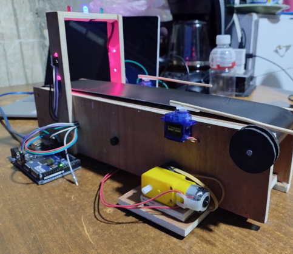
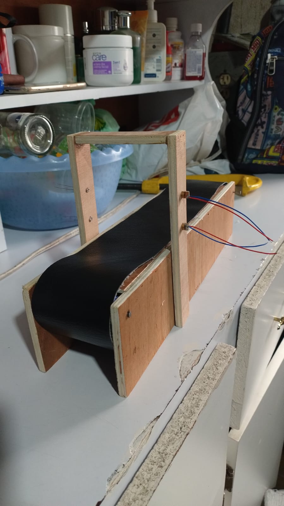
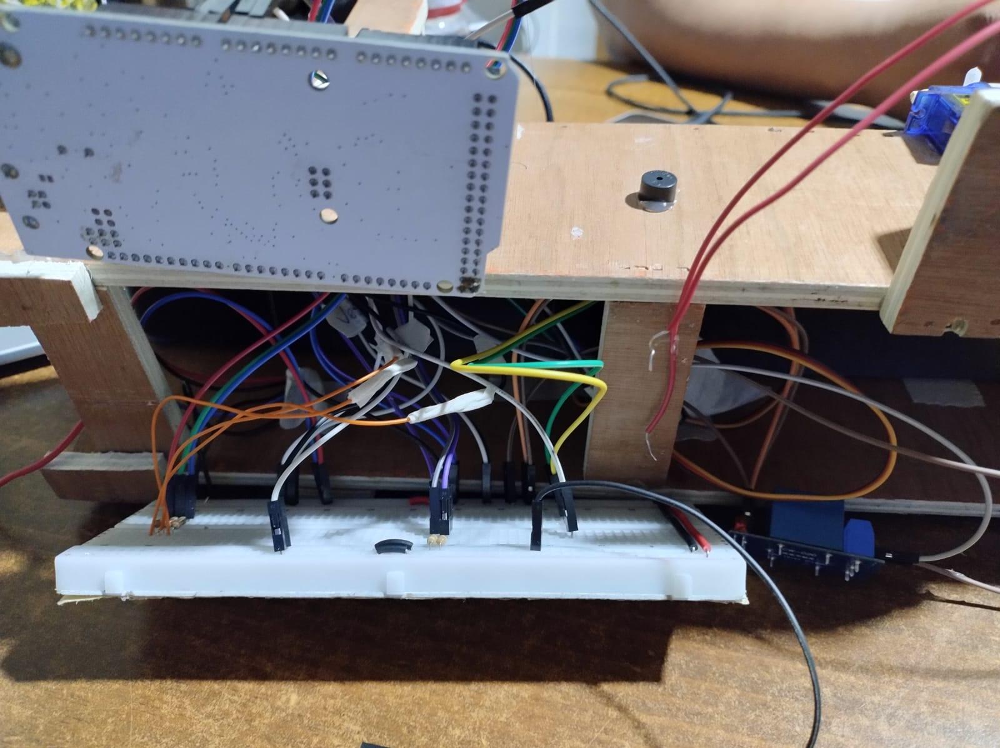
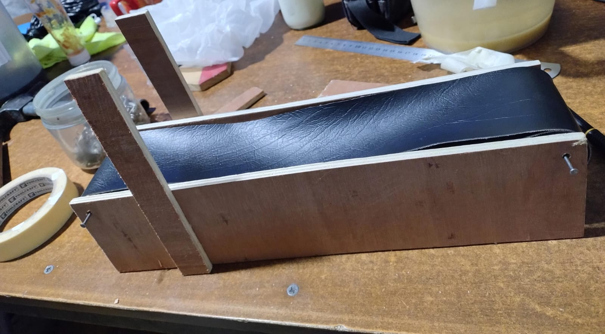
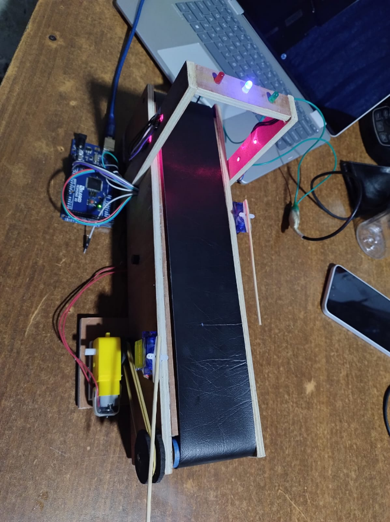
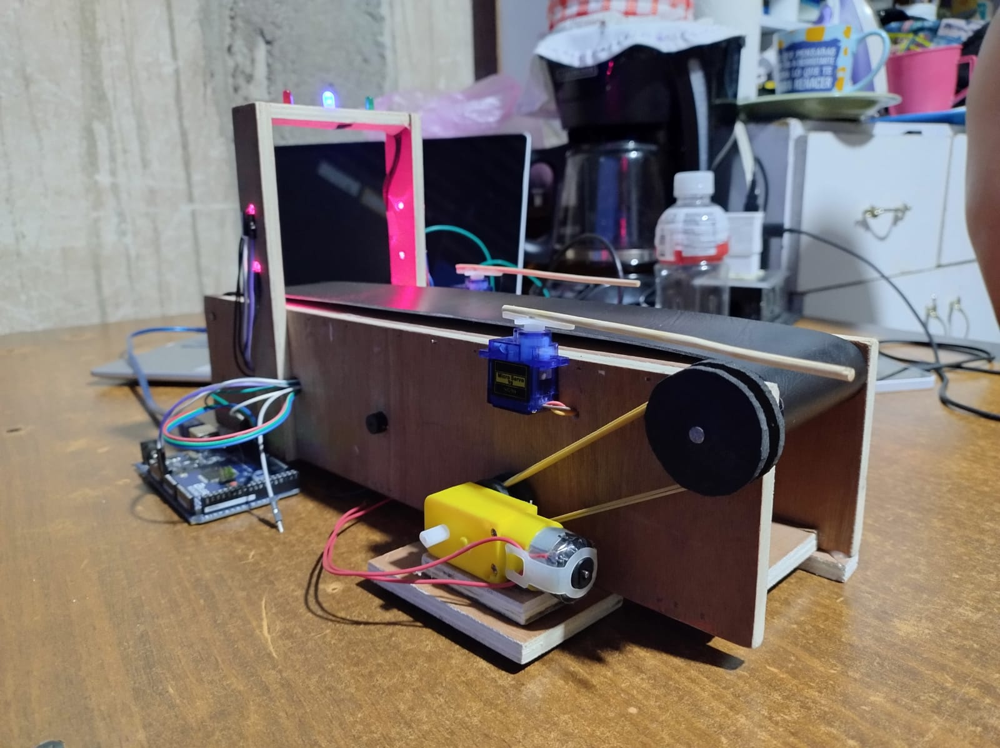
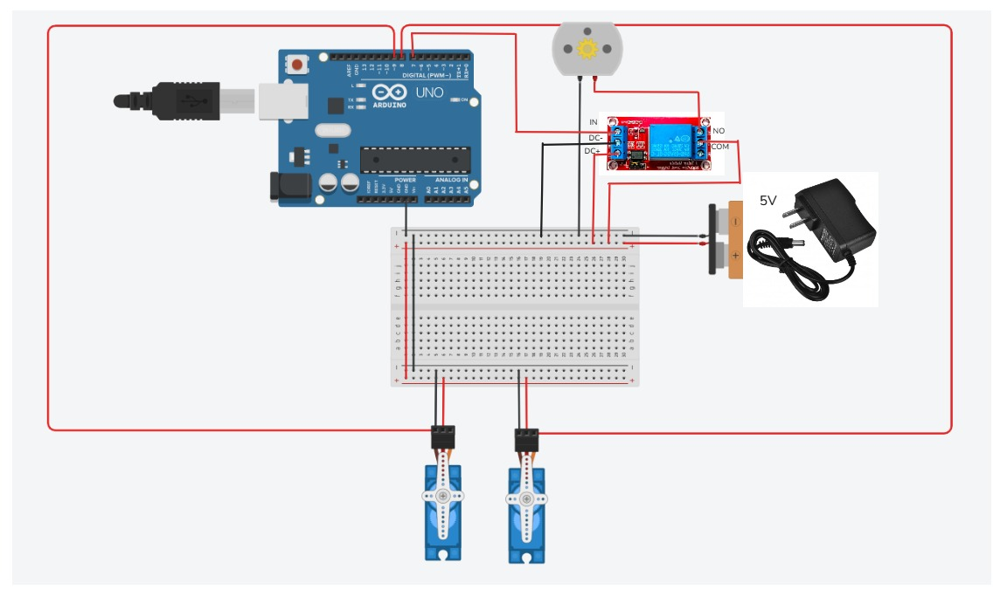

# Organización Computacional

## Proyecto - SmartSort GT

**Universidad de San Carlos de Guatemala**  
**Facultad de Ingeniería - Ingeniería en Ciencias y Sistemas**  
**Semestre:** Segundo Semestre 2026

**Estudiante 1:** Diego José Castro Lux - 202300627

**Estudiante 2:** Ludsvin Anthony Marcelino Cuxum Cahuec - 202300497

**Estudiante 3:** Jonathan Eduardo Fuentes Garcia - 202408977

**Estudiante 4:** Andre Emanuel Negreros Pacaya - 202401461

---

## Introducción

SmartSort GT es un sistema automatizado de clasificación de paquetes desarrollado con Arduino. Utiliza dos sensores LDR para identificar paquetes grandes, pequeños y rechazados, una banda transportadora y servomotores para controlar la clasificación. También incorpora una pantalla LCD, comunicación Bluetooth, indicadores LED y un buzzer para facilitar el control y la supervisión del proceso.

El sistema almacena las estadísticas de clasificación en la memoria EEPROM del Arduino, permitiendo conservar los contadores de paquetes y el total histórico. Este repositorio presenta imágenes del montaje físico, diagramas de los circuitos y las tablas de asignación de direcciones EEPROM utilizadas en el proyecto.

---

## Imágenes del montaje físico

### Montaje general

  

## Banda transportadora

  

##  Circuito de control 

  

##  Evidencia fotográfica 1

  

##  Evidencia fotográfica 2

  

##  Evidencia fotográfica 3

  

---

## Diagramas del circuito

### Diagrama general de conexiones

## Tabla de asignación de direcciones EEPROM

La memoria EEPROM se utiliza para almacenar los contadores de paquetes grandes, pequeños, rechazados y el total histórico. Los datos se guardan y recuperan mediante las funciones `EEPROM.put()` y `EEPROM.get()`.

| Dato almacenado | Dirección inicial | Tipo de dato | Tamaño | Función |
|---|---:|---|---:|---|
| Paquetes grandes (`pGrandes`) | 0 | `int` | 2 bytes | Guarda la cantidad de paquetes grandes |
| Paquetes pequeños (`pPequenos`) | 2 | `int` | 2 bytes | Guarda la cantidad de paquetes pequeños |
| Paquetes rechazados (`pRechazos`) | 4 | `int` | 2 bytes | Guarda la cantidad de paquetes rechazados |
| Total histórico (`totalHistorico`) | 6 | `long` | 4 bytes | Guarda el total acumulado de paquetes |

**Nota:** Las direcciones y tamaños corresponden al uso habitual de `int` de 2 bytes y `long` de 4 bytes en Arduino Uno y Mega. Los valores se almacenan consecutivamente, sin superponerse.

### Distribución de memoria

| Dirección EEPROM | Contenido |
|---|---|
| 0–1 | Contador de paquetes grandes |
| 2–3 | Contador de paquetes pequeños |
| 4–5 | Contador de paquetes rechazados |
| 6–9 | Total histórico |

---